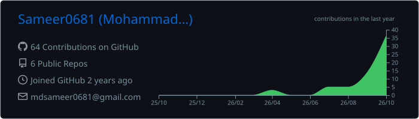
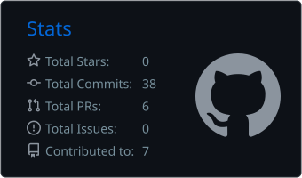
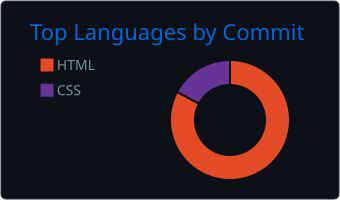
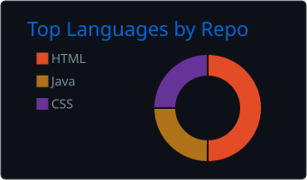

<div align="center">
  
</div>

<p align="center">
  <a href="#about">About</a> &nbsp;·&nbsp;
  <a href="#focus">Focus</a> &nbsp;·&nbsp;
  <a href="#tech-stack">Stack</a> &nbsp;·&nbsp;
  <a href="#featured-projects">Projects</a> &nbsp;·&nbsp;
  <a href="#github-overview">Stats</a> &nbsp;·&nbsp;
  <a href="#contact">Contact</a>
</p>

<p align="center">
  <a href="YOUR_LINKEDIN_URL"></a>
  <a href="mailto:YOUR_EMAIL_ADDRESS"></a>
  <a href="YOUR_PORTFOLIO_URL"></a>
</p>

---

## About

I'm a Computer Science and Engineering student who enjoys turning ideas into working web applications. I can write Java and build basic Spring Boot CRUD APIs, and I'm working toward independently designing, implementing, debugging, and deploying real-world applications.

```java
public class MohammadSameer {
    String role       = "Aspiring Java Full Stack Developer";
    String studying   = "B.Tech, Computer Science & Engineering";
    String learning   = "Spring Boot, REST APIs, database design";
    String building   = "Full stack projects with Java and Spring Boot";
    String lookingFor = "Internships and entry-level opportunities";
}
```

---

## Focus

| Area | What I'm working on |
|:--|:--|
| **Java** | Core Java and object-oriented design |
| **Backend** | Cleaner Spring Boot applications and REST APIs |
| **Data** | Database design with MySQL and MongoDB |
| **Integration** | Connecting backend services to the frontend |
| **Delivery** | Debugging and deploying applications independently |

**Objective:** become a capable Java Full Stack Developer who can take a feature from idea to working, deployed software.

---

## Tech Stack

| Category | Technologies |
|:--|:--|
| **Languages** |    |
| **Backend** |    |
| **Frontend** |     |
| **Databases** |   |
| **Tools** |    |

---

## Featured Projects

| 🏛️ &nbsp;**[CivicResolve](https://github.com/YOUR_GITHUB_USERNAME/YOUR_CIVICRESOLVE_REPO)** |
|:--|
| A citizen grievance management project focused on complaint categorization, urgency and sentiment analysis, and escalation workflows.<br><br> <br>**Stack:** ADD_VERIFIED_TECHNOLOGIES |

| 🧰 &nbsp;**[Tool Ultima](https://github.com/YOUR_GITHUB_USERNAME/YOUR_TOOL_ULTIMA_REPO)** |
|:--|
| A web-based productivity platform intended to offer a resume builder, portfolio builder, and resume checker.<br><br> <br>**Stack:** HTML · CSS · JavaScript · Spring Boot |

| 🛍️ &nbsp;**[ViastaStore](https://github.com/YOUR_GITHUB_USERNAME/YOUR_VIASTASTORE_REPO)** |
|:--|
| A clothing e-commerce website project exploring how a storefront frontend connects to a Java backend and a relational database.<br><br><br>**Stack:** HTML · CSS · JavaScript · Java · Spring Boot · MySQL |

| 📈 &nbsp;**[PriceIQ](https://github.com/YOUR_GITHUB_USERNAME/YOUR_PRICEIQ_REPO)** |
|:--|
| A mini-project exploring product data and machine learning for price prediction, built to practice data handling and basic modeling.<br><br><br>**Stack:** Python · pandas · NumPy · scikit-learn |

| 👤 &nbsp;**[Personal Portfolio](https://github.com/YOUR_GITHUB_USERNAME/YOUR_PORTFOLIO_REPO)** |
|:--|
| A developer portfolio website presenting my skills, projects, and background.<br><br> <br>**Stack:** HTML · CSS · JavaScript · Spring Boot |

---

## GitHub Overview

<table width="100%">
  <tr>
    <td width="50%" align="center" valign="top">
      
    </td>
    <td width="50%" align="center" valign="top">
      
    </td>
  </tr>
  <tr>
    <td width="50%" align="center" valign="top">
      
    </td>
    <td width="50%" align="center" valign="top">
      
    </td>
  </tr>
</table>

<sub>Language cards show code composition across my repositories, not programming proficiency. Cards are generated by a GitHub Action in this repository and refresh daily.</sub>

---

## Contact

| | |
|:--|:--|
| **LinkedIn** | [YOUR_LINKEDIN_URL](YOUR_LINKEDIN_URL) |
| **Email** | [YOUR_EMAIL_ADDRESS](mailto:YOUR_EMAIL_ADDRESS) |
| **Portfolio** | [YOUR_PORTFOLIO_URL](YOUR_PORTFOLIO_URL) |

---

<p align="center">
  <i>Building one project at a time, and getting better with each commit.</i>
</p>
